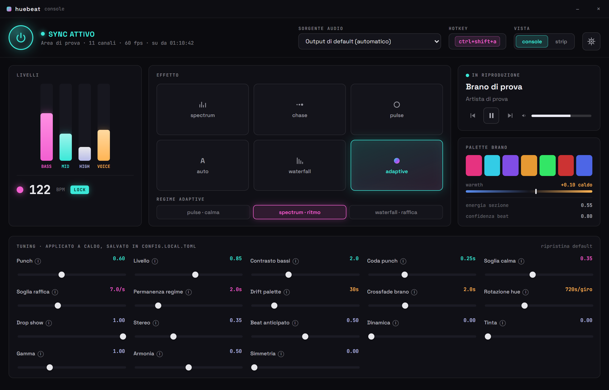
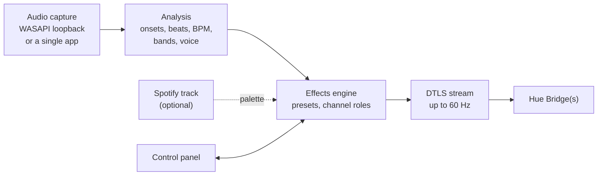

<p align="center">
  
</p>

<h1 align="center">Huebeat</h1>

<p align="center">
  <b>Real-time music sync for Philips Hue lights on Windows.</b>
</p>

<p align="center">
  
  
  
  
  
</p>

Huebeat captures the system audio (or a single app), analyses it (beats, bass,
vocals) and drives the lights through the Hue Entertainment API over a local
DTLS stream at up to 60 Hz. It was built to do better than Hue Sync desktop:
faster reactions and colour choices that follow the music.

<p align="center">
  
  <br>
  <sub>The control panel (sample data): live levels and BPM, effect presets, now playing with the track palette, live tuning knobs. The UI is in Italian.</sub>
</p>

## How it works



## Features

- **Audio capture**: WASAPI loopback of any output device, or per-application
  capture (for example only Spotify, so games and voice chat do not move the
  lights).
- **Analysis**: onset and beat tracking, frequency bands, BPM lock and a vocal
  presence estimate.
- **Effects**: six presets. `adaptive` switches by itself between calm
  passages (unified breathing), normal rhythm (spectrum) and fast bursts
  (waterfall: every hit runs along the strip). The others are the single
  regimes plus `chase` and `auto`.
- **Per-channel roles**: `bass`, `rest` (everything except bass), `mid`,
  `high`, `voice`, or automatic spatial distribution (left = bass, centre =
  mids, right = highs). Gradient lights are driven per segment.
- **Multi-bridge**: one entertainment area per bridge, several bridges at once.
- **Spotify (optional)**: a colour palette generated for each track (the same
  song always gets the same colours), with crossfade on track change and
  playback controls (PKCE login with your own client id, Premium needed for
  the controls).
- **Desktop app**: control panel in a native window with live tuning knobs,
  global hotkey to pause the lights, tray icon and start with Windows.

## Requirements

- Windows 10 or 11; per-app capture needs Windows build 20348 or later
  (in practice Windows 11)
- WebView2 runtime (already present on Windows 11)
- Hue Bridge v2 (square) on the same network, with an entertainment area
  created in the Hue app
- Python 3.14 or later to run from source

## Run from source

```powershell
py -3.14 -m venv .venv
.\.venv\Scripts\python.exe -m pip install -e .
.\.venv\Scripts\python.exe -m huebeat pair   # first time: press the bridge button
.\.venv\Scripts\python.exe -m huebeat app    # control panel
.\.venv\Scripts\python.exe -m huebeat run    # headless
```

Close Hue Sync desktop and the Entertainment section of the Hue mobile app
first: the bridge accepts a single streaming client. With silence the lights
stay off on purpose.

## Configuration

- `config.toml`: neutral defaults, versioned.
- `config.local.toml`: written by the control panel, overrides `config.toml`
  (not versioned).
- `.env`: bridge credentials and the optional Spotify client id (copy
  `.env.example`; pairing fills the bridge values).
- `.bridges.json`: paired bridges when more than one is used (not
  versioned).

The packaged build keeps its data in `%APPDATA%\huebeat`; deleting that folder
brings the app back to first start. `build_exe.ps1` builds the Windows
executable with PyInstaller.

## Project layout

- `huebeat/`: audio capture, analysis, effects, DTLS streaming, bridge store,
  web UI and CLI
- `native/hb_loopback/`: small C++ helper that captures the audio of a single
  process with the Windows Process Loopback API, based on Microsoft's MIT
  licensed ApplicationLoopback sample
- `assets/`: icon and README images

## License

MIT, see [LICENSE](LICENSE). Parts adapted from other projects keep their
licenses: see [THIRD_PARTY_NOTICES.md](THIRD_PARTY_NOTICES.md).
